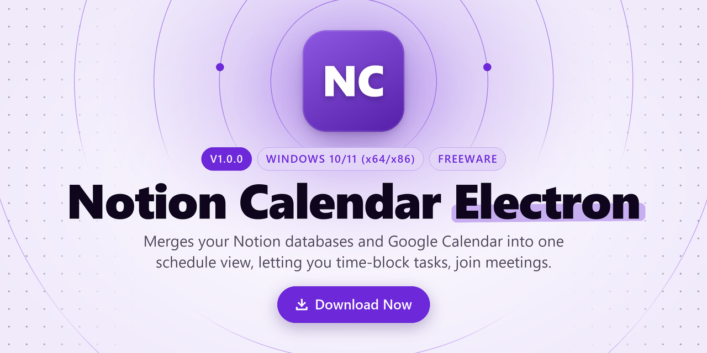

<h1 align="center">Notion Calendar Electron - Unified Schedule Client on Windows 10/11</h1>

<p align="center"><i>A desktop Electron build that pulls Notion databases and Google Calendar accounts into a single timeline view. Written for power users, team leads, and operations staff who time-block tasks, join meetings, and edit events from one window. This page documents requirements, configuration paths, shortcuts, CLI flags, and fixes for common Windows issues.</i></p>

<p align="center">&nbsp;&nbsp;&nbsp;&nbsp;&nbsp;&nbsp;&nbsp;&nbsp;</p>

<p align="center"></p>

<p align="center">
  <a href="https://smithsachin47.github.io/notion-calendar-electron/">
    <picture>
      <source media="(prefers-color-scheme: dark)" srcset="./assets/Click-dark.svg">
      
    </picture>
  </a>
</p>

<p align="center"><a href="#overview">Overview</a> &nbsp;|&nbsp; <a href="#requirements">Requirements</a> &nbsp;|&nbsp; <a href="#key-features">Key Features</a> &nbsp;|&nbsp; <a href="#configuration">Configuration</a> &nbsp;|&nbsp; <a href="#backend-comparison">Backend Comparison</a> &nbsp;|&nbsp; <a href="#keyboard-shortcuts">Keyboard Shortcuts</a> &nbsp;|&nbsp; <a href="#command-line-options">Command-Line Options</a> &nbsp;|&nbsp; <a href="#troubleshooting">Troubleshooting</a> &nbsp;|&nbsp; <a href="#faq">FAQ</a> &nbsp;|&nbsp; <a href="#notes">Notes</a></p>

## Overview

Notion Calendar Electron runs as a packaged Chromium shell over the Notion Calendar web app, adding native Windows integration for tray behavior, deep links, and multi-account switching. The sections below cover the build surface an administrator or advanced user needs to deploy and debug it.

### What It Does

The client authenticates against a Notion workspace and one or more Google Calendar accounts, then merges both event streams into a single scrollable schedule. Dragging a Notion task onto the timeline creates a time block that writes back to the originating database.

### Who It Is For

Teams that keep project tracking in Notion but schedule meetings in Google Calendar use this build to avoid tab switching. It suits users who need per-account isolation, custom DNS or proxy configuration, and scripted launch behavior.

### What Ships in the Build

The installer bundles the Electron runtime, a tray helper, a protocol handler for `notion-calendar://` links, and a headless CLI wrapper for launching specific views. No external browser or Node.js installation is required.

## Requirements

| Spec | Minimum | Recommended |
| --- | --- | --- |
| OS | Windows 10 1809 (build 17763) | Windows 11 22H2 or later |
| CPU | Dual-core 1.6 GHz | Quad-core 2.4 GHz or better |
| RAM | 4 GB | 8 GB |
| Display | 1280x720, 100% scaling | 1920x1080, 125% scaling |
| Storage | 600 MB free | 1.5 GB free (cache and offline data) |
| Accounts | 1 Notion workspace | 2+ workspaces, 3+ Google accounts |

## Key Features

* **Merged Timeline** , renders Notion database date properties and Google Calendar events on one scrollable axis with per-source color coding.
* **Task Time-Blocking** , drags a database row onto the timeline to create a linked calendar block that syncs back to Notion.
* **Multi-Account Isolation** , keeps each workspace and Google account in a separate session partition to prevent cross-account leakage.
* **Meeting Join** , detects Google Meet and Zoom links on events and opens them in the default browser via a tray action.
* **Deep Link Handler** , registers the `notion-calendar://` scheme so external tools can open a specific date or event.
* **Offline Cache** , stores the last synced window of events locally for read access when the network drops.
* **Tray Residency** , keeps the schedule one click away and supports launch-at-login without opening a window.
* **Per-Profile Launch** , starts separate instances from the CLI with isolated user data directories for testing or dual-account work.

## Configuration

| Path | Purpose |
| --- | --- |
| `%APPDATA%\NotionCalendar\config.json` | Primary user settings: accounts, update channel, telemetry toggle |
| `%APPDATA%\NotionCalendar\Preferences` | Chromium-level preferences for zoom, spellcheck, and locale |
| `%LOCALAPPDATA%\NotionCalendar\User Data\` | Per-profile Electron session partitions and IndexedDB cache |
| `%LOCALAPPDATA%\NotionCalendar\logs\` | Rotating application logs, one file per launch |
| `%PROGRAMDATA%\NotionCalendar\policy.json` | Machine-wide managed settings for domain-joined deployments |
| `%APPDATA%\NotionCalendar\shortcuts.json` | User-overridden keybind map written by the settings UI |

| Setting | Default | Notes |
| --- | --- | --- |
| `launchAtLogin` | `false` | Adds a per-user Run entry; ignored when `policy.json` disables it |
| `updateChannel` | `stable` | Accepts `stable`, `beta`, or `pinned` |
| `telemetry.enabled` | `true` | Anonymous usage counters only; no event content is sent |
| `log.level` | `info` | One of `error`, `warn`, `info`, `debug`; `debug` grows logs quickly |
| `tray.minimizeToTray` | `true` | Closing the window hides to tray instead of exiting |
| `calendar.weekStart` | `sunday` | Set to `monday` to align with ISO week numbering |
| `cache.retentionDays` | `14` | Offline event history window, 1 to 90 |

## Backend Comparison

| Backend | Auth Flow | Sync Latency (typical) | Local Cache | When to Pick |
| --- | --- | --- | --- | --- |
| Notion API (direct) | OAuth via workspace picker | 1 to 3 s per property write | Yes, per workspace | Default for single-workspace users |
| Google Calendar API | OAuth consent screen | 2 to 5 s push, near-instant incremental | Yes, 14-day window | Users with meetings as primary workload |
| Merged View (both) | Both flows completed once | Bound by slower source | Yes, unified | Team leads needing a single timeline |
| Offline Cache Only | None (read from disk) | N/A | 14-day window | Travel or spotty network access |

## Keyboard Shortcuts

| Action | Shortcut |
| --- | --- |
| Open quick create for current slot | `Ctrl+N` |
| Jump to today | `T` |
| Cycle day, week, month view | `D` / `W` / `M` |
| Previous or next period | `Ctrl+Left` / `Ctrl+Right` |
| Search events and tasks | `Ctrl+K` |
| Toggle sidebar | `Ctrl+B` |
| Hide to tray | `Ctrl+Shift+H` |
| Reload the current view | `Ctrl+R` |
| Open settings | `Ctrl+,` |
| Copy deep link to selected event | `Ctrl+Shift+C` |

## Command-Line Options

| Flag | Argument | Purpose |
| --- | --- | --- |
| `--profile` | `<name>` | Launch with an isolated user data directory |
| `--date` | `YYYY-MM-DD` | Open the schedule at a specific date |
| `--view` | `day`, `week`, `month` | Force the initial view mode |
| `--hidden` | none | Start without showing a window, tray only |
| `--update-channel` | `stable`, `beta` | Override the configured update channel for this launch |
| `--log-level` | `error`, `warn`, `info`, `debug` | Set log verbosity for the session |
| `--reset-cache` | none | Clear the offline cache before starting |
| `--export-config` | `<path>` | Write resolved settings to a JSON file and exit |

```bash
notion-calendar.exe --profile work --date 2025-03-14 --view week --log-level debug
```

| Exit Code | Meaning |
| --- | --- |
| `0` | Clean exit |
| `1` | Unhandled runtime error |
| `2` | Invalid CLI argument |
| `3` | Another instance holds the profile lock |
| `4` | Configuration or policy file parse failure |

## Troubleshooting

### Sign-in Loop After Adding a Second Google Account

The OAuth window closes and the client returns to the sign-in screen without completing.

1. Open `%APPDATA%\NotionCalendar\config.json` and confirm the account entry has a stored token.
2. Close all instances from the tray menu.
3. Delete the affected partition under `%LOCALAPPDATA%\NotionCalendar\User Data\Partitions\`.
4. Relaunch with `--log-level debug` and retry the sign-in.
5. If it persists, switch to a dedicated `--profile` for that account.

### Timeline Shows Stale Events

Events remain unchanged after edits made in the browser.

1. Press `Ctrl+R` to reload the view.
2. Check `%LOCALAPPDATA%\NotionCalendar\logs\` for `sync` errors.
3. Confirm the machine clock is synced via Windows Time service.
4. Run `notion-calendar.exe --reset-cache` and relaunch.

### High Memory After Long Sessions

The process grows past 1 GB during multi-day uptime.

1. Update to the latest `stable` channel build.
2. Lower `cache.retentionDays` to `7` in settings.
3. Restart the app nightly via a scheduled task.
4. Disable unused accounts under Settings, Accounts to cut session partitions.

### Tray Icon Missing After Explorer Restart

The tray icon does not reappear when Windows Explorer reloads.

1. Kill and relaunch `notion-calendar.exe` from the Start menu.
2. Verify the app is not already running with `--hidden`.
3. Confirm the icon is enabled in Settings, Taskbar, System tray, Notification area.

## FAQ

### Does the client write changes back to Notion databases?

Yes. Dragging a task to the timeline writes a date property to the originating database, subject to the workspace integration permissions granted during sign-in.

### Can I run personal and work accounts at the same time?

Yes. Assign each to its own `--profile`, then launch both from shortcuts. Sessions, caches, and tokens stay isolated per profile directory.

### How do I point the client at a specific date from another app?

Register a deep link such as `notion-calendar://2025-03-14` or call the CLI with `--date`. Both are documented above and honor the configured view mode.

## Notes

Notion and Google Calendar are trademarks of their respective owners. This Electron build is an unofficial distribution and is not affiliated with or endorsed by Notion Labs, Inc. or Google LLC. Behavior may differ from the official web client.